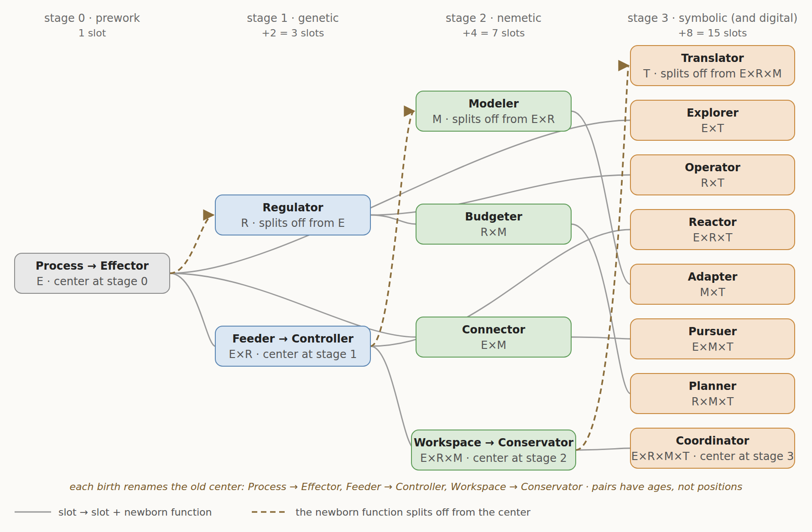

# The Venn's ontogeny

The Venn grows. One circle is born per line, each new function splitting off from the center of the Venn as it stands, and the fifteen-slot Venn is the fourth and last stage of a sequence that begins with one circle. The earlier stages are not discarded; each sits inside the next as a region, still running.

---

## What a function is

A function is a role in a process — not a part of the unit and not a substance in it. The Effector is not the material half and the stores are not the informational half: the Regulator's correction is a pump, the Modeler's store is a synapse, the Effector's act is a muscle, and all four are matter doing something. A function is defined by what it does — by what the unit would lack if that doing stopped — and one piece of machinery can play more than one role, as a single molecule in the RNA world both acts and stores.

What a function never carries is intention. A unit wants in the sense a thermostat wants, and every "for" in this document is a free-floating rationale: a reason the arrangement pays, held by nothing, comprehended by no one. There are four: doing, holding, revising, rendering.

## Process

The name for stage 0 is a commitment. Before there is a unit there is activity: a reaction cycle that sustains its own inputs, a gradient that maintains itself by dissipating, a boundary that reforms. Things are patterns that activity settles into and keeps up, not the other way round; a unit is a process that has acquired a store. This is process biology, and the document stands in it.

It also settles where the old question of machines and organisms belongs. Kant's organism is cause and effect of itself, its parts producing one another; Polanyi's machine is a boundary condition harnessing chemistry that the chemistry does not explain. A self-sustaining reaction cycle passes Kant's test and not yet Polanyi's, because no boundary condition has separated from the chemistry it would harness — the question is undecidable at stage 0, and that is not a defect of the question. Both words become apt at stage 1, where the store is the unit's own: the cell is the paradigm machine and the paradigm organism because the specification that harnesses its chemistry is inside it and made by it.

**Terms.** *Process* is the doing: activity that keeps itself going, with no store. A *unit* is a process with functions — the thing that has a Venn — and the center of its Venn names the whole of it. *Machine* and *organism* are the stage-1 unit read from two sides, harnessed chemistry and self-production. A *store* is a part of a unit playing the holding role of the Regulator or the Modeler; detached from its process a store is a part and not a unit — a virus is a store with no process of its own, inert until hosted, playing the Regulator's holding role inside a host's loop — and it sits on no rung of the ladder because the ladder ranks units. Any part playing any role, detached from its process, is inert in the same way; that is what a role is. A *carrier* is the token the test touches — an organism, a performance, a telling, a run — and the *Effector* is the role that mints carriers. A *replicator* is what is copied; it sits in a line, not on the ladder.

## The rule

**Each new function splits off from the center of the Venn, and the old center is renamed for what it keeps doing without the function that left it.**

The center is the region inside every existing circle — the whole unit running. A new function is born there because a new kind of memory can only be selected on the performance of the whole unit, and the whole unit is what the center is. When the function splits off, the function space is divided between the newborn and what remains, and what remains is no longer the whole unit: it is the whole unit *minus* the newborn, and it takes a name that says so.

- At stage 0 the Venn is one circle, a process that keeps itself going. The **Regulator** splits off from it. The old center becomes the **Effector**: the process without a reference.
- At stage 1 the center is the loop of process and reference, the **Feeder** — the unit taking in to keep itself. The **Modeler** splits off from it. The old center becomes the **Controller**: the loop without a revisable store.
- At stage 2 the center is the arena where three loops compete, the **Workspace**. The **Translator** splits off from it. The old center becomes the **Conservator**: the arena without an exit.
- At stage 3 the center is the **Coordinator** — the unit whose loop closes through other units — and no function splits from it.

Three births, three renames, one operation. The center at each stage is also the clade's breakthrough, so the rule says where the next function comes from: each new function is born from the prior line's last breakthrough. The digital line's founding is a change of medium rather than a birth, and the four functions re-run in it.

## The slot space

The slots are the non-empty subsets of the functions that exist: one, then three, then seven, then fifteen. A Venn diagram is one display of that set, and the display carries no information the set does not. A four-set Venn has to draw two of its six pairs across the middle of the figure, and which two is a choice: the Translator can be drawn between Effector and Regulator, between Regulator and Modeler, or between Modeler and Effector, and the theory is the same in each. Nothing about a pair follows from where it is drawn. There are no adjacent pairs and no opposite pairs; there are six pairs, and every one of them is a loop.

Every pair is a loop because every function is complete at what it does and incomplete on its own, and its lack recruits each of the others. Action cannot see its result; a reference supplies the comparison, a store supplies the picture, a rendering supplies the receiver. A reference cannot enforce itself, look ahead, or act; an arm, a store, and a rendering supply those. A store built from the unit's own traffic has no test, no standard, and no content it did not generate; action, reference, and rendering supply them. A rendering has no physical form, no standard, and nothing to render without the other three. Six pairs, twelve lacks, each pair the answer to two.

What a pair has instead of a position is an age. The pair of process and reference is born at stage 1. The two pairs containing the Modeler are born together at stage 2. The three pairs containing the Translator are born together at stage 3. A slot's age says which lines it has run in and which it has not, and that is the only structural fact a slot carries beyond its composition.

## The fate map

Every slot at stage *n* has exactly one descendant at stage *n+1*: itself plus the newborn function. The newborn function alone is born from the center. One slot, then two new, then four, then eight: fifteen. The slots born at a stage are exactly the slots that contain the newborn function, so the footprint rule — a slot is new if and only if it contains the newborn function — is the birth rule. Within a line the slots are occupied; at a line boundary new ones are born.

## The ladder

Each line adds one property to memory.

| Stage | Newborn | What it adds | In one line |
|---|---|---|---|
| prework | Effector | process | chemistry that keeps itself going |
| genetic | Regulator | memory | a stored reference the process is held to |
| nemetic | Modeler | **revisable** memory | a reference the unit itself rewrites from its own experience |
| symbolic | Translator | **transmissible** memory | a reference rendered so another unit can take it up |
| digital | — | a plan that **runs itself** | a screened rendering executed by a machine built to its terms |

The two late functions are defined by write-back rather than by register. **Modeler:** a store the unit rewrites from its own traffic. **Translator:** a rendering that leaves the unit in a code held in common, persists, and is copied into units that do not share its internals — each unit translating between its own store and the shared code, outward on emission and inward on uptake. A genome is the lineage's model, walled from what its carrier goes through — it is not the unit's to rewrite, so it is a Regulator's store, not a Modeler's. A signal that is not in a code is not a rendering. Both definitions are testable per mechanism: does what the unit goes through rewrite the store; is what leaves it in a code held in common.

The gene is a Regulator. A stored reference that outlives the state it sets, corrected toward by proofreading and repair, is the comparator half of a Regulator with the store half. What precedes it is chemistry that sustains itself without storing anything. A gradient maintained by pumping is a held state, not a stored value: a stable equilibrium, not regulation. The RNA world sits on the seam, a molecule that both does and stores, the doer and the copy not yet separated.

## The lines

A line is a Darwinian population plus its medium: something varies, something is tested, something is copied. There are as many lines as there are named replicators — four — and nothing in the geometry caps the count.

| Line | What is copied | Whose store it is | What the test touches | The test |
|---|---|---|---|---|
| genetic | the gene | the Regulator's — a reference walled from its carrier | the organism | survival and reproduction under finite carrying capacity |
| nemetic | the neme — a stored form read out as performances, whose consequences rewrite the store that emits them | the Modeler's — rewritten by its carrier's traffic | the performance | the outcome of expressed behavior, scored inside the unit |
| symbolic | the meme | the Translator's — the rendering itself, corrected to the nearest word at each retelling | the telling | uptake: taken up and retold, or let die |
| digital | the program | the Planner's product — a rendering screened against reference and store, run by machinery built to its terms | the running process | being run and kept: invoked, copied, depended on |

**Three lines are founded on a primary's store; the fourth on a triple's product.** The gene is the Regulator's store, the neme the Modeler's, the meme the Translator's: each of the first three lines begins when the store of its newborn function first runs as a replicator. The ladder and the list of replicators are one list read twice. The program is different in kind. It is a plan — the Planner's product, a rendering prepared and screened against a model of its test — and what the digital line adds is not a new store but an executor built to the plan's terms, so that the plan runs itself. Its regime is the least Darwinian of the four for exactly that reason: its replicator is screened before it is ever copied.

**The program is a plan that runs itself.** The digital line has the same three-way structure as the nemetic: a host (the machine), a store (the software), and a carrier (the run). The store is separable from its host, as a gene is and an engram is not — it can be lifted off one process and run on another intact — and it is open to write-back, as an engram is and a gene is not. It is authored: written as an object against a held model of what it is for. Authoring is the Planner's operation, and it is older than the line — a tool shaped against a model of its use, a sentence composed against a model of its uptake, a law drafted against a model of its enforcement are all Planner products of the memetic line, executed by machinery other than the planner's: a hand, a listener, a court. What the digital line changes is the machinery. A plan whose executor is built to its terms runs without a mind to interpret it, and a plan that runs without interpretation is a unit.

**The carrier is the run, and a training pass is a run.** A carrier is the token through which a store meets its line's test, and the digital test is adoption, so the carrier is the run that is invoked and depended on. A training pass is the same act with a different fate: output produced, scored against a reference, the error written into the weights, the run discarded. Every line above the first has both fates for its carrier — the practice bout and the fight, the draft and the telling — and the store is rewritten by the scored ones whether or not they are the ones the line's test reaches. What is particular to the digital line is a regime, not a second carrier: scored runs outnumber adopted runs by orders of magnitude, and where every scored run precedes release the store is rewritten only before it is copied — screened before copied. Where a released run is also scored, the two fates coincide, as they do in an animal.

**The carrier shrinks.** What the test touches is the whole unit at the genetic line and a single act everywhere above it: an organism, then a performance, then a telling, then a run. The Effector is the function that mints carriers — the interacting, not the interactor — and it looks like the disposable body only at the genetic line, where the token the test touches happens to be the whole cell. From the nemetic line up, store, host, and carrier are three things: the host houses the store, and the Effector spends the host on carriers the test can reach.

**The test is met at the center.** Every line's test touches the whole unit, and the whole unit is the center of that line's Venn: the genetic test bites on the Feeder, the nemetic test on the Workspace — where the outcome lands and rewrites the store that produced the act — the symbolic test on the Coordinator, which is the machinery for seeing uptake, and the digital test on execution. That is why a new function is born from the center: it is selected where the test bites. No line's test is a thing and nothing owns it; selection is a statistic over carriers, and no unit, organ, or clade holds it.

**The medium precedes the line.** Each line's medium is laid down by the prior line's last center, one clade before the line begins, and the line begins when a replicator runs in it. A circle is born at the founding clade, where the new medium makes the new store possible. The last clade of a line is one where the next medium exists and no replicator yet runs in it.

**Weismann and Lamarck.** The Regulator's store is walled — what the carrier goes through does not edit it — which is Weismann's barrier stated as a slot property, and the reason the genetic carrier is disposable. The Modeler's birth is the barrier coming down inside the unit: the nemetic line is the first Lamarckian line, and revisable memory is what Lamarckian means. The symbolic store is edited by every retelling; the digital store is patched, versioned and retrained in place — walled, open, open, open. Bit-perfect copying is a fact about the copy, not a wall around the store.

**The split is born, not inherited.** At stage 0 there is nothing to be dual about: a flame carries nothing, and the RNA-world molecule is doer and copy at once. The distinction between what is copied and what carries it is a stage-1 event — a store separating from the process that runs on it — and after it the distinction is between roles, not substances. That is the residue left when the substance reading is refused, and it is not a residue to remove: something was selected for keeping a copy apart from the thing that acts, and that is what makes copying possible.

**The newborn's store pervades its line; its operation does not.** Because the newborn function's store is the line's replicator, it is in every unit from the founding clade — the genome in every cell, the engram in every animal, the word in every group. The newborn's *operation* is another matter: it becomes a separable occupant of its own slot only once the line is under way. And because a slot seats an operation and not a history, a mechanism *produced by* the newborn function runs wherever its own operation puts it: a behavior built by learning runs as a Controller if the outcome no longer rewrites it, and a store built by rendering runs sealed if nothing about it is emitted. The newborn's store being everywhere is what makes it the replicator; it does not make every operation the newborn's.

**The thread is one; the tests are not.** The table follows a single line of descent, and an address on it claims nothing about lineages that branched below it. Every center elaborates, on every branch, and a branch's elaboration can meet a function's test while the function is not yet born on the counted thread: a plant's stress priming is a store rewritten by what the plant went through; a song copied from a tutor and corrected toward the population's version is a rendering. Three things are then distinct that the thread runs together. A mechanism that meets the test is seated at the function, wherever it occurs. A line runs only where the function's store runs as a replicator — a song tradition is a thin one, and priming founds none. A birth is the function splitting from the center, which puts it in every pair at once. On the thread, the center elaborating before the birth meets the test the same way — in every pair, since the center already holds every function — and what separates that from the birth is not the pairs but the line: whether the rewritten store is kept or undone by the outcome of its own read-outs. A function met off the thread was not born from that lineage's center, and it pairs only with what its medium reaches. What a rendering medium does not reach, off the thread, is the Effector: a song directs no hand, so nothing the rendering produces is left in the world, and the loop it closes runs through other units and never through things — what accumulates is bounded by one head, and the tradition cycles where it would otherwise ratchet. Range is set the same way. A code carries what the store holds, and a store filled by a body that takes the world apart and puts it back together holds parts and their recombinations; a code that renders those can take its own renderings as content, and a code that renders identities and states cannot. A song carries its own form, a signature whistle an address, a sentence anything. Range is a register fact, not a seat, and the Effector sets it.

| Line | Clades, in order | What the last clade lays down |
|---|---|---|
| genetic | Prokaryote · Archaeon · Eukaryote · Eumetazoa | nervous tissue |
| nemetic | Bilaterian · Vertebrate · Mammal · Primate | mentalizing and tool-making |
| symbolic | Band-Human · Settlement-Human · City-Human · Empire-Human | formal systems whose execution is still interpretation |
| digital | Computer · Network · Model · Agent | — |

Each line begins at its first clade, when a replicator runs in the medium the prior line's last clade laid down; the prework, at RNA World, precedes the first. A clade is an address on the thread. Which operations a unit at that address runs, and which slots seat them, is decided per mechanism by the tests below.

## Seating

A mechanism is seated at the smallest slot whose functions its operation requires. Four tests decide whether a function is required.

- **The world-action test for the Effector.** The mechanism does something whose description is not exhausted by holding and consulting, revising, or rendering: moves, builds, transports, transforms, secretes, emits, pulls apart. The Effector is the floor — an operation that requires no reference, no revisable store and no shared code is the Effector alone, because the Effector is the stage-0 process under its later name and there is no slot with nothing in it — and in a compound it is judged last, as the doing left over once the other three are accounted for. Correction of the held variable is the Regulator's own arm and does not add the Effector, whatever its physical form: a pump that moves ions toward a setpoint is a Regulator; a body moved to where the setpoint can be met is a Controller.
- **The held-reference test for the Regulator.** The mechanism holds a stored value it can be wrong about and consults it — matches against it, reads it out, scores by it. A gradient maintained by pumping is a held state, not a held value. Whether the loop closes by correcting toward the reference, and through what — the unit's own state, or action on the world — is a fact about the kind of loop, not about whether the Regulator is present.
- **The write-back test for the Modeler.** A store inside the unit is rewritten by what the unit's own acts go through — what they met or what they produced — so that the unit's response to the same input met again is not what it was: revises, updates, strengthens, weakens, lays down, lets fade. The change outlives what produced it; a shift that tracks the current input and re-equilibrates when the input is withdrawn is a held state, not a rewritten store. The edit passes through a run of the unit, whoever schedules the run, chooses what it meets, or sets the reference it is scored against; content placed in the store without passing through a run — a variant the lineage fixed, a patch, a hand-set value — is a reference-write, and a store written only that way is a reference. Selection that keeps or drops a store on its carrier's outcome does not compute the edit from it, and is not write-back. Whether the rewrite is itself scored — kept or undone by the outcome of the acts that read it out — is a fact about a line, not about the seat. A good regulator contains a model, and the Modeler is the one that revises it.
- **The retelling test for the Translator.** What leaves the unit, or arrives in it, is in a code that would survive retelling. The test is of the code, not of the act: three properties are required of the code, and the act need only translate into it or out of it — says, writes, signs, serializes, encodes; hears, reads, parses, takes up. *Re-emittable:* any user of the code can put out its forms; a form only its originator can produce, or that a receiver can only respond to, is not in a code. *Tokened:* the code's forms are discrete and its users correct toward them; a word is a token whether or not the act that used it is ever retold, and a signal with no form to correct toward is not in a code. *Held in common:* the code is what the units share, and they need share nothing else — not a store, not a lineage's repertoire, not a build. A form that works only because the receiver shares the sender's internals — the call the lineage fixed in both, the gene carried across and read by the same machinery, the genome injected — is readout or transfer, not rendering; a rendering crosses in the code's terms and is read by a receiver that holds nothing of the sender's but the code. Whether a given rendering is in fact retold is a fact about a line, not about the seat. Causation across units is not enough — every social act computes its effect inside another animal, and none of that is rendering.

Seat the operation, not its history. A habit built by revision and now running without it is seated as the loop it runs, not as the loop that built it. Seat by requirement, not by mention: a description that names a function the mechanism could run without has named too much, and a description that leaves out a function the mechanism cannot run without has named too little. For the triples, the absent function is the seat's definition, so the check is that the mechanism runs *without* it and not merely that the description omits it. The kind of reference — a setpoint, a floor, a ceiling, a norm, a contract — and the kind of store are register facts, not slot facts; a mechanism's line does not change its slot.

## The slots

Each slot is described at its birth, then at every later stage it runs in. The description at a later stage is the same slot with more neighbors, not a different slot.

### Stage 0 — one slot

**Process (E), renamed Effector at stage 1.** A process that keeps itself going: a reaction cycle that sustains its own inputs, a boundary that reforms. Nothing is held, stored, revised, or rendered; there is only the fact that the chemistry does something rather than sitting still, and that what persists is what there is more of. This is the whole unit at stage 0, and there is no unit in any stronger sense — no boundary held to a value, nothing the process could be wrong about.

### Stage 1 — three slots

**Effector (E).** The process without a reference: execution, the spending of the unit's resources on a change in the world. Seated here when a mechanism gives physical form or motion to something and its description needs no comparison, no revisable store, and no receiver — remove every reference and it still does what it does, only without correcting. Not here when the description needs "against a setpoint" (that adds the Regulator), "learned" (the Modeler), or "taken up by" (the Translator). The register verb changes from line to line; the slot does not.

**Regulator (R).** A stored reference and what consults it: a value the machinery can be wrong about, held apart from the state it governs and read against — matched, scored by, corrected toward. The reference is held: it is not revised by what the carrier goes through, though it may be set by the lineage or by a higher loop. Seated here when a mechanism holds a value and consults it and nothing else is required — no action on the world, no revision from experience, no rendering; correction of the unit's own state toward the value is one way the loop closes and is not required for the seat. Not here when the setpoint moves with experience (the Budgeter), when correction requires acting on the world (the Controller), or when the reference is held in terms another party enforces (the Operator). Contains a model in the good-regulator sense — a regulator that works is behaviorally an isomorph of what it regulates — and that model is not the Modeler's, because the unit cannot rewrite it.

**Feeder (E×R), renamed Controller at stage 2.** The closed loop of process and reference: act, compare, correct. At stage 1 this is the whole unit — a bounded process held to a stored specification, taking in to keep itself — and it is the center. The loop is where an overlap is first seen to be a loop rather than a blend of two things, and the loop's setting is the first dimension along which units of one kind differ. Seated here when both action on the world and correction toward a held value are required and nothing is revised or rendered.

### Stage 2 — seven slots

**Modeler (M).** A store inside the unit rewritten by what the unit's own acts go through; what the unit meets is allowed to write, not only to be corrected against. Seated at the bare Modeler when a mechanism's operation is the revision of the store from the unit's own experience and nothing else is required — perception as the account remade from prediction error, consolidation, the curation of what the store keeps and lets fade. Not here when the revising content arrives as another unit's rendering (the Adapter), when the revised store drives action (the Connector), or when it informs a held reference (the Budgeter). The test is write-back: a store written only without passing through a run of the unit — by the lineage, by a patch, by a hand — is a Regulator's store.

**Controller (E×R).** The loop of process and reference, now without a revisable store: the model-free path, closed through valence directly. What it keeps doing without the Modeler is what a Controller is: a mapping from error to action that the outcome does not rewrite. Seated here when action on the world and correction toward a held value are both required and the outcome revises nothing — a consolidated habit runs here whatever built it. Not here when the mapping changes with experience (that adds the Modeler and moves the mechanism to the center or one of the Modeler's pairs), or when the loop's product is read by another unit (the Reactor).

**Budgeter (R×M).** Regulation run ahead of its errors: a held reference informed by the revisable store, so that correction is issued before the error arrives rather than after. The loop closes through the unit's own correction arm — visceromotor, autonomic, internal — and not through action on the world. This is predictive regulation: the body run on a forecast. Seated here when a held reference and a revisable store are both required, the loop stays inside the unit, and nothing is rendered — in either direction: the store informing the reference, or the reference scoring the store, with the revision computed from error against a held target. The signs are anticipatory adjustment before demand, setpoints that move with predicted load, and a modeled object whose modeled state has regulatory consequence. Not here when the correction is a movement in the world (the Connector or the Workspace), or when the reference is held in terms another party enforces and the store tracks that party (the Planner).

**Connector (E×M).** Action driven by the revisable store and the store revised by the action's outcome: model-based action, perception through action, action through prediction. The loop closes through movement in the world — the unit samples the world by acting and plans its acting from what it sampled. Seated here when action on the world and a revisable store are both required and the loop closes between them without a held value scoring the outcome and without rendering. The clean case is latent learning: the store revised by exploration with no reward scoring it. The store can contain the actor itself — which any model-based planner has to carry — and can contain other agents; sociality is what this loop becomes when the store contains other agents, not what the loop is. Not here when the outcome is scored against a stored expectation and the policy rewritten (the Workspace), or when the act is put out for receivers (the Explorer or the Pursuer).

**Workspace (E×R×M), renamed Conservator at stage 3.** The arena where the three loops' candidates compete for one body's expression: act, reference, and revisable store all in play. One body does one thing at a time, so something has to arbitrate, and the arena is the answer to what the Modeler lacks — room to enumerate the cases. At stage 2 this is the center, and its content at each clade is the breakthrough. The paradigm operation is reinforcement in its full form — act, score the outcome against expectation, revise the store that produced the act — which is what separates this slot from the Connector: add a held value that scores the outcome and latent learning becomes reinforcement. Seated here when all three functions are required and nothing is rendered.

### Stage 3 — fifteen slots

**Translator (T).** A rendering that leaves the unit in a code held in common, persists, and is copied into units that do not share its internals. The sender's store is not in the common code and neither is the receiver's; the rendering is the store's content translated into the shared code, and uptake translates it into the receiver's own store, which is why the sender cannot check the effect. Seated at the bare Translator when a mechanism's operation is the translation itself — the store's content put into the shared code, or the shared code taken into a store — and nothing else is required. Not here when the act that puts the rendering into the open is required (the Explorer), when the rendering is what revises the unit's own store (the Adapter, which is the receiving side of the same traffic), or when the rendering is of a held reference for a second party to enforce (the Operator). Not here when what crosses is not in a code — is responded to rather than re-emitted, corrects to no token, or works only because the receiver shares the sender's internals — a display, a call, a groom, a reconciliation are traffic between model-based animals with one another in the store, and contain no Translator. Not here when the store itself moves; transfer is not rendering. The retelling test is decisive.

**Conservator (E×R×M).** The Workspace without an exit: the arena of act, reference, and revisable store, running sealed, its product consumed only by the machinery that produced it. What it keeps doing without the Translator is everything the stage-2 unit does, now inside a unit that can render — and this slot is what stays unrendered. Seated here when all of act, reference, and revision are required and nothing about the operation is emitted, offered, or receivable. Not here when any part of the product is read by another unit.

**Adapter (M×T).** The store revised by renderings from outside: a copy arrives in the shared code and is taken into the store, so the store now holds a token the unit did not author. Learning from others' renderings lives here; learning from the unit's own traffic does not, and neither does learning from another animal as an object in the world — a conspecific's behavior read as one more event the model tracks, or a performance reproduced with no token to correct toward, is the Connector or the Workspace with the other in the store. Seated here when a revisable store and an inbound copy are both required and no action or held reference is required. Not here when the revising content comes from the unit's own action (the Connector), or when what is revised is a held reference (the Planner).

**Explorer (E×T).** The act as emission: a rendering given physical form and put into the open where receivers the unit cannot see determine its fate — probes, displays, broadcasts. Seated here when action on the world and rendering are both required and no store is revised by the return and no held value shapes the emission. Not here when the emission is governed by a reference receivers enforce (the Reactor), or when what comes back revises the store (the Pursuer).

**Operator (R×T).** A held reference rendered so that a second party can read and enforce it: accountability. The loop runs from a value the unit holds, through a rendering of it, to receivers who hold the unit to it — a reference others can hold the unit to is one it cannot quietly drop. Seated here when a held reference and a rendering of it are both required, the enforcement is outside the unit, and no action and no revision are required. Not here when the reference is private (the Regulator), when what comes back revises it (the Planner), or when the unit acts under the standard (the Reactor).

**Reactor (E×R×T).** Accountable action by protocol with no revisable store: the unit acts, is held to a reference, and traffics with receivers — signals taken up and renderings put out — with nothing represented in between. Trafficking without a picture: where the partner is stable, a protocol costs less than a picture. Seated here when action, a held reference, and rendering are all required and nothing revises. Not here when the partner is modeled (the Pursuer or the Coordinator), or when nothing is rendered (the Controller).

**Planner (R×M×T).** The rendering prepared and screened against reference and store before any act, with execution belonging to other machinery — or to a receiver that does not yet exist. A rendering checked before it leaves costs less than one recalled. Design is this slot's operation: a product shaped against a model of what it is for, by a process that does not itself carry it out. Seated here when a held reference, a revisable store, and a rendering are all required and no action is: deliberation as the rehearsal of candidate renderings, gating that decides a step without taking it. Not here when the mechanism executes what it prepared (the Coordinator), or when no reference screens the rendering (the Adapter).

**Pursuer (E×M×T).** Action and rendering with a revisable store and no held reference: the unit engages a second party on the other's ground, revises from what comes back, and holds nothing it defends or is corrected by. What must be taken up in another's terms cannot be held to one's own, which is why this slot produces acquisition across a boundary. Seated here when action, revision, and rendering are all required and no held value governs the engagement. Not here when a reference governs (the Coordinator), or when nothing is revised (the Explorer).

**Coordinator (E×R×M×T).** All four functions: the unit whose loop closes through other units of its kind. Renderings go out, uptake comes back — as a reply, a shared state, a record, a reliance — and the unit's references and stores adjust to what returned. This is the answer to what the Translator lacks, access to uptake, and every breakthrough at this stage is a mechanism for seeing it. Seated here when all four are required: the mechanism acts, holds a reference, revises a store, and renders, and its operation closes only when another unit's response arrives. The Coordinator is the whole unit at stage 3, as the Feeder was at stage 1 and the Workspace at stage 2, and no function splits from it.

## Nesting

The three-slot Venn is the sub-Venn of the fifteen that contains neither Modeler nor Translator. The seven-slot Venn is the Translator-free sub-Venn. The stage-1 unit's whole Venn sits inside the stage-2 unit's as the Controller region, and the stage-2 unit's whole Venn sits inside the stage-3 unit's as the Conservator region. Every slot that was once a center is now named for what it keeps doing without the function that split from it. Covered layers keep running is, in this architecture, a picture rather than a sentence.

## Names

Function names are fixed through evolutionary history. Register names change per line — the same function has a different verb in each medium — and there are thirteen of them — one for each function in each line it exists in — plus the prework process. A slot is renamed exactly when a function splits off from it: process to Effector, Feeder to Controller, Workspace to Conservator. No other slot is ever renamed. Names are contrastive, so each function is introduced under a plain word — process, memory, revisable memory, reproducing rendering — and takes its role name at the birth that gives it something to contrast with.

## The metaphors' division of labor

**The embryo is the derivation engine.** Its payload is topological: new structures fold out of old ones and the old sheet is still there. Gastrulation makes an inside, a bounded unit held to a reference. Neurulation folds a tube off the tissue that already integrates everything — the Modeler off the Feeder. Organogenesis differentiates the fifteen. The center is the organizer and each birth is an induction. Von Baer, not Haeckel: general features before special ones, the earlier Venn the general form the later one specializes — never an adult bacterium inside an adult human. The hazard is that development is programmed and the metaphor invites reading the sequence as one.

**Dennett is the corrective and the voice.** Free-floating rationales are the discipline every slot above is stated in: a reason with no reasoner, which is the same constraint as costs-never-payments and cui-bono-assigns-lineages. Design space is the map, and the ladder is the sequence of cranes. The tower maps onto the circles — Skinnerian is the Modeler's birth, Popperian is Connector plus Workspace, Gregorian is the Translator — so the metaphor arrives with a known reading of the same four steps. What it cannot say is where a new region opens; that is the embryo's.

**Powers gives the ladder its direction.** Assembly climbs by splitting; control descends by reference-setting. The Modeler sets the Regulator's reference, the Translator sets the Modeler's content, the executed rendering sets the Translator's terms. A higher loop sets the reference for the loop below, and that is why the sequence is ordered rather than merely listed.
