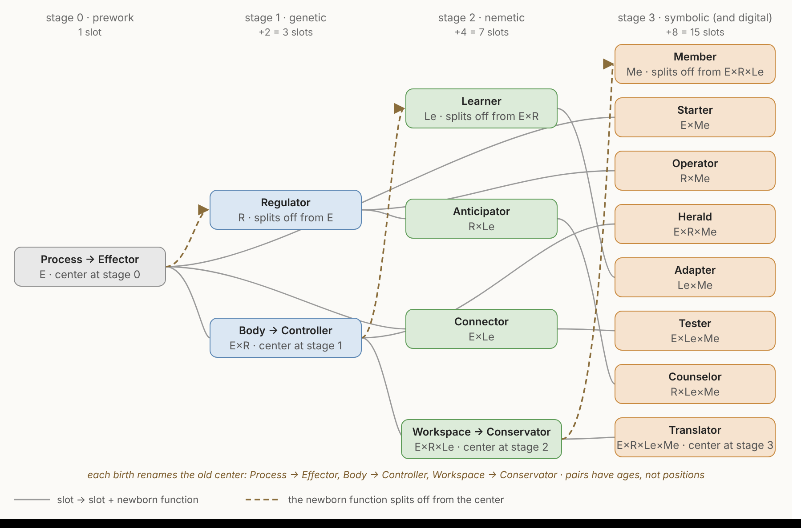

# The Venn's ontogeny

The Venn grows. One circle is born per line, each new function splitting off from the center of the Venn as it stands, and the fifteen-slot Venn is the third and last stage of a sequence that begins with one circle. The earlier stages are not discarded; each sits inside the next as a region, still running.

---

## What a function is

A function is a role in a process — not a part of the unit and not a substance in it. The Effector is not the material half and the stores are not the informational half: the Regulator's correction is a pump, the Learner's store is a synapse, the Effector's act is a muscle, and all four are matter doing something. A function is defined by what it does — by what the unit would lack if that doing stopped — and one piece of machinery can play more than one role, as a single molecule in the RNA world both acts and stores.

What a function never carries is intention. A unit wants in the sense a thermostat wants, and every "for" in this document is a free-floating rationale: a reason the arrangement pays, held by nothing, comprehended by no one. There are four: doing, holding, revising, rendering. No function is named for the shape of its store or for a property of the center it split from. The Learner is named by the plain word for revising, because every regulator already contains a model: a regulator that works is behaviorally an isomorph of what it regulates, so a model is what the Regulator has, and the newborn on the nemetic line is not the model but the revising of it. The Member is named for what holding a code makes a unit — a part of a larger one.

## Process

The name for stage 0 is a commitment. Before there is a unit there is activity: a reaction cycle that sustains its own inputs, a gradient that maintains itself by dissipating, a boundary that reforms. Things are patterns that activity settles into and keeps up, not the other way round; a unit is a process that has acquired a store. This is process biology, and the document stands in it.

It also settles where the old question of machines and organisms belongs. Kant's organism is cause and effect of itself, its parts producing one another; Polanyi's machine is a boundary condition harnessing chemistry that the chemistry does not explain. A self-sustaining reaction cycle passes Kant's test and not yet Polanyi's, because no boundary condition has separated from the chemistry it would harness — the question is undecidable at stage 0, and that is not a defect of the question. Both words become apt at stage 1, where the store is the unit's own: the cell is the paradigm machine and the paradigm organism because the specification that harnesses its chemistry is inside it and made by it.

**Terms.** *Process* is the doing: activity that keeps itself going, with no store. A *unit* is a process with functions — the thing that has a Venn — and the center of its Venn names the whole of it. *Machine* and *organism* are the stage-1 unit read from two sides, harnessed chemistry and self-production. A *store* is a part of a unit playing the holding role of the Regulator, the Learner or the Member; detached from its process a store is a part and not a unit — a virus is a store with no process of its own, inert until hosted, playing the Regulator's holding role inside a host's loop — and it sits on no rung of the ladder because the ladder ranks units. Any part playing any role, detached from its process, is inert in the same way; that is what a role is. A *carrier* is the token the test touches — an organism, a performance, a telling, a run — and the *Effector* is the role that mints carriers. A *replicator* is what is copied; it sits in a line, not on the ladder.

## The rule

**Each new function splits off from the center of the Venn, and the old center is renamed for what it keeps doing without the function that left it.**

The center is the region inside every existing circle — the whole unit running. When the function splits off, the function space is divided between the newborn and what remains, and what remains is no longer the whole unit: it is the whole unit *minus* the newborn, and it takes a name that says so.

- At stage 0 the Venn is one circle, a process that keeps itself going. The **Regulator** splits off from it. The old center becomes the **Effector**: the process without a reference.
- At stage 1 the center is the loop of process and reference, the **Body** — the unit taking in to keep itself. The **Learner** splits off from it. The old center becomes the **Controller**: the loop without a revisable store.
- At stage 2 the center is the arena where three loops compete, the **Workspace**. The **Member** splits off from it. The old center becomes the **Conservator**: the arena without an exit.
- At stage 3 the center is the **Translator** — the unit whose loop closes through other units — and no function splits from it, so it keeps one name.

Three births, three renames, one operation. The digital medium is not a birth: the memetic line's fifteen slots run in it unchanged, with an executor added.

## The slot space

The slots are the non-empty subsets of the functions that exist: one, then three, then seven, then fifteen. A Venn diagram is one display of that set, and the display carries no information the set does not. A four-set Venn has to draw two of its six pairs across the middle of the figure, and which two is a choice: the Member can be drawn between Effector and Regulator, between Regulator and Learner, or between Learner and Effector, and the theory is the same in each. Nothing about a pair follows from where it is drawn. There are six pairs, and every one of them is a loop.

Every pair is a loop because every function is complete at what it does and incomplete on its own, and its lack recruits each of the others. Action cannot see its result; a reference supplies the comparison, a store supplies the picture, a rendering supplies the receiver. A reference cannot enforce itself, look ahead, or act; an arm, a store, and a rendering supply those. A store built from the unit's own traffic has no test, no standard, and no content it did not generate; action, reference, and rendering supply them. A rendering has no physical form, no standard, and nothing to render without the other three. Six pairs, twelve lacks, each pair the answer to two.

What a pair has instead of a position is an age. The pair of process and reference is born at stage 1. The two pairs containing the Learner are born together at stage 2. The three pairs containing the Member are born together at stage 3. A slot's age says which lines it has run in and which it has not, and that is the only structural fact a slot carries beyond its composition.

## The fate map

Every slot at stage *n* has exactly one descendant at stage *n+1*: itself plus the newborn function. The newborn function alone is born from the center. One slot, then two new, then four, then eight: fifteen. The slots born at a stage are exactly the slots that contain the newborn function, so the footprint rule — a slot is new if and only if it contains the newborn function — is the birth rule. Within a line the slots are occupied; at a line boundary new ones are born.

## The ladder

Each line adds one property to memory.

| Stage | Newborn | What it adds | In one line |
|---|---|---|---|
| prework | Effector | process | chemistry that keeps itself going |
| genetic | Regulator | memory | a stored reference the process is held to |
| nemetic | Learner | **revisable** memory | a reference the unit itself rewrites from its own experience |
| memetic | Member | **transmissible** memory | a reference rendered so another unit can take it up |

The memetic line runs in two media. In the symbolic medium a rendering is executed by interpretation — a listener, a hand, a court. In the digital medium it is executed by a machine built to its terms: a plan that **runs itself**. The medium adds an executor and no function, so the ladder has three rungs and the Venn has fifteen slots in both. Which functions a given digital clade's units run is found, not assumed: a computer running fixed code consults a stored specification and renders in a shared code and does not learn, and the Learner is met in the medium where weights are fit from what runs go through. What a line forces is that no function appears below its birth; it does not promise every function at every clade of a later line.

The two late functions are defined by write-back rather than by register. **Learner:** a store the unit rewrites from its own traffic, at the grain of the encounter, so that what was met chooses where the edit lands and the store afterward holds a relation among things met that the lineage did not wire. **Member:** a rendering that leaves the unit in a code held in common, persists, and is copied into units that do not share its internals — each unit rendering between its own store and the shared code, outward on emission and inward on uptake. A genome is the lineage's model, walled from what its carrier goes through — it is not the unit's to rewrite, so it is a Regulator's store, not a Learner's. A signal that is not in a code is not a rendering. Both definitions are testable per mechanism: does what the unit goes through rewrite the store at the grain of what it met; is what leaves it in a code held in common.

The gene is a Regulator. A stored reference that outlives the state it sets, corrected toward by proofreading and repair, is the comparator half of a Regulator with the store half. What precedes it is chemistry that sustains itself without storing anything: autocatalytic cycles, vesicles that grow and divide, nucleotides forming from simpler molecules. A gradient maintained by pumping is a held state, not a stored value: a stable equilibrium, not regulation. The RNA world is where the seam is crossed, in a molecule that both does and stores. A template consulted during copying is a held value — the copy can be wrong about it — and the holding is walled, because nothing the strand does while it catalyzes edits its own sequence. Both halves of the Regulator's definition are met there, so the Regulator is born at RNA World, in the same molecule that acts, and the genetic line begins there: the template is the replicator, and strands that copy faster or truer under a finite supply of nucleotides are the test. Storing is holding, and what the first clade lacks is neither a function nor a replicator. The store comes apart from the doer at the Ribocyte, where the template is read into a different molecule; a DNA archive is kept apart from the working copies at the Progenote; a lineage's heredity is first its own at LUCA, where the organism becomes the carrier the test touches. Each is an install at that clade's cells, found there as every install is found, and none is a birth. No function on the thread is met below its birth.

A held reference is not always a scalar. The gene is a recipe, not a map: it produces a body and tracks nothing. But a tissue's pattern of membrane voltage, set across cells joined by gap junctions, holds a target anatomy that regeneration restores — a planarian cut in half rebuilds the body the pattern specifies, and a pattern reset by a brief perturbation is rebuilt to, intact, through rounds of regeneration with the genome unchanged. That is a map-shaped reference: spatial, relational, corrected toward, and not rewritten by anything the animal does. It is the Regulator at its most elaborate on the genetic line, and the nervous system's map of the body descends from it; the gap junction is the ancestor of the electrical synapse. A map that tracks and is restored is still a Regulator's. What the Learner adds to a map is revision from the unit's own outcomes.

## The lines

A line is a Darwinian population plus its medium: something varies, something is tested, something is copied. There are as many lines as there are named replicators — three — and nothing in the geometry caps the count.

| Line | What is copied | Whose store it is | What the test touches | The test |
|---|---|---|---|---|
| genetic | the gene | the Regulator's — a reference walled from its carrier | the strand, and from LUCA the organism | survival and reproduction under finite carrying capacity |
| nemetic | the neme — a stored form read out as performances, whose consequences rewrite the store that emits them | the Learner's — rewritten by its carrier's traffic | the performance | the outcome of expressed behavior, scored by the unit |
| memetic | the meme — the rendering itself, corrected to the nearest token at each retelling; in the digital medium, the program | the Member's | the telling; in the digital medium, the run | uptake: taken up and retold, or let die; in the digital medium, being run and kept — invoked, copied, depended on |

**Every line is founded on its newborn's store.** The gene is the Regulator's store, the neme the Learner's, the meme the Member's: each line begins when the store of its newborn function first runs as a replicator. The ladder and the list of replicators are one list read twice.

**The program is the meme in a medium built to run it.** It is a plan — the Counselor's product, a rendering prepared and screened against a model of its test — and what the digital medium adds is not a new store but an executor built to the plan's terms, so that the plan runs itself. The medium has the same three-way structure as the nemetic line: a host (the machine), a store (the software), and a carrier (the run). The store is separable from its host, as a gene is and an engram is not — it can be lifted off one process and run on another intact — and it is open to write-back, as an engram is and a gene is not. It is authored: written as an object against a held model of what it is for. Authoring is the Counselor's operation, and it is older than the medium — a tool shaped against a model of its use, a sentence composed against a model of its uptake, a law drafted against a model of its enforcement are all Counselor products of the symbolic medium, executed by machinery other than the author's: a hand, a listener, a court. What the digital medium changes is the machinery. A plan whose executor is built to its terms runs without a mind to interpret it, and a plan that runs without interpretation is a unit. Its regime is the least Darwinian in the matrix for exactly that reason: its replicator can be screened before it is ever copied.

**The carrier is the run, and a training pass is a run.** A carrier is the token through which a store meets its line's test, and the digital test is adoption, so the carrier is the run that is invoked and depended on. A training pass is the same act with a different fate: output produced, scored against a reference, the error written into the weights, the run discarded. Every line above the first has both fates for its carrier — the practice bout and the fight, the draft and the telling — and the store is rewritten by the scored ones whether or not they are the ones the line's test reaches. What is particular to the digital medium is a regime, not a second carrier: scored runs outnumber adopted runs by orders of magnitude, and where every scored run precedes release the store is rewritten only before it is copied — screened before copied. Where a released run is also scored, the two fates coincide, as they do in an animal.

**The carrier shrinks.** What the test touches is the whole unit at the genetic line and a single act everywhere above it: an organism, then a performance, then a telling or a run. The Effector is the function that mints carriers — the interacting, not the interactor — and it looks like the disposable body only at the genetic line, where the token the test touches happens to be the whole cell. From the nemetic line up, store, host, and carrier are three things: the host houses the store, and the Effector spends the host on carriers the test can reach.

**The test is met at the center.** Every line's test touches the whole unit, and the whole unit is the center of that line's Venn: the genetic test bites on the Body, the nemetic test on the Workspace — where the outcome lands and rewrites the store that produced the act — and the memetic test on the Translator, which is the machinery for seeing uptake; in the digital medium it bites on execution. The statistic over carriers is a thing nothing owns — no unit, organ, or clade holds it.

**The genetic test is uncomputed; every later test is computed.** Nothing scores a gene: a variant is in the next generation or it is not, and no edit is computed from the outcome. From the nemetic line up something inside the unit scores the carrier. Write-back is the rewrite itself, scored or not: a route laid down by pairing two things met is write-back before anything scores it, and where a score exists it is error against the body's held values. The nemetic unit's soma, what its test spends, is the Workspace: the attending self, the arena one body's single act is chosen in, as the Body is the genetic unit's soma.

**The medium precedes the line.** Each line's medium is laid down by the prior line's last center, one clade before the line begins, and the line begins when a replicator runs in it. A circle is born at the founding clade, where the new medium makes the new store possible. The last clade of a line is one where the next medium exists and no replicator yet runs in it.

**Weismann and Lamarck.** The Regulator's store is walled — what the carrier goes through does not edit it — which is Weismann's barrier stated as a slot property, and the reason the genetic carrier is disposable. The Learner's birth is the barrier coming down inside the unit: the nemetic line is the first Lamarckian line, and revisable memory is what Lamarckian means. The memetic store is edited by every retelling, and in the digital medium it is patched, versioned and retrained in place — walled, open, open. Bit-perfect copying is a fact about the copy, not a wall around the store.

**The split is born, not inherited.** At stage 0 there is nothing to be dual about: a flame carries nothing. The distinction between what is copied and what carries it is the stage-1 event, and it is a distinction between roles from the first: the RNA-world molecule is doer and copy at once, and the roles are already two, because a copy can be wrong about its template and nothing can be wrong about a flame. The roles come apart into different molecules at the Ribocyte, and that separation is what lets fidelity be bought without taxing the catalysis; it is not what makes copying possible. That is the residue left when the substance reading is refused, and it is not a residue to remove: something was selected for keeping a copy held apart from what acts on it, as a role before it was a molecule.

**The newborn's store pervades its line; its operation does not.** Because the newborn function's store is the line's replicator, it is in every unit from the founding clade — the genome in every cell, the engram in every animal, the word in every group. The newborn's *operation* is another matter: which slots it occupies at a clade is found, not given. And because a slot seats an operation and not a history, a mechanism *produced by* the newborn function runs wherever its own operation puts it: a behavior built by learning runs as a Controller if the outcome no longer rewrites it, and a store built by rendering runs sealed if nothing about it is emitted. The newborn's store being everywhere is what makes it the replicator; it does not make every operation the newborn's.

**The thread is one; the tests are not.** The table follows a single line of descent, and an address on it claims nothing about lineages that branched below it. Every center elaborates on every branch, and a branch's elaboration can meet a function's test while the function is not yet born on the counted thread: a song copied from a tutor and corrected toward the population's version is a rendering in a vertebrate. Three things are then distinct that the thread runs together. A mechanism that meets the test is seated at the function, wherever it occurs. A line runs only where the function's store runs as a replicator — a song tradition is a thin one. A birth is the function splitting from the center on the thread, which puts it in every pair at once. A function met off the thread is **convergent**: it was not born from that lineage's center, and it is the same role played by different parts. A song learned by matching a tutor seats as the Translator off the thread: the emission is doing, the bird's own singing rewrites its store through what it hears of itself, the kept tutor form is both the token corrected toward and a value the copy is scored against, and the song is in a code the population holds. All four run in one bird, and what makes the tradition thin is the line fact, not the seat. On the thread the rule is stricter: no function's test is met below its birth, and a read that meets one is the definition leaking, with the definition the first suspect and the clade the last. Range is set the same way. A code carries what the store holds, and a store filled by a body that takes the world apart and puts it back together holds parts and their recombinations; a code that renders those can take its own renderings as content, and a code that renders identities and states cannot. A song carries its own form, a signature whistle an address, a sentence anything. Range is a register fact, not a seat, and the Effector sets it.

| Line | Clades, in order | What the last clade lays down |
|---|---|---|
| prework | pre-template chemistry (stage 0, no address) | activated nucleotides and untemplated polymers: the nucleic medium |
| genetic | RNA World · Ribocyte · Progenote · LUCA · Prokaryote · Eukaryote · Metazoa | the synaptic toolkit |
| nemetic | Eumetazoa · Bilaterian · Vertebrate · Mammal · Primate | mentalizing and tool-making |
| memetic, symbolic medium | Band-Human · Settlement-Human · City-Human · Empire-Human | formal systems whose execution is still interpretation |
| memetic, digital medium | Computer · Network · Model · Agent | — |

Each line begins at its first clade, when a replicator runs in the medium the prior line's last clade laid down. The prework precedes the first: chemistry that sustains itself and stores nothing, which makes the nucleotides and the polymers the first replicator will run in. It is a one-slot Venn and has no addresses to tabulate. The genetic line's three deepest clades are RNA World, where doer and copy are one molecule and the template is the replicator; Ribocyte, where translation reads the store into a different molecule; and Progenote, where a DNA archive emerges while heredity is still communal. Each has three cells. The genetic line ends at Metazoa, which lays down the synaptic toolkit — sponges carry the postsynaptic scaffold with no neurons and no synapses — and the nemetic line begins at Eumetazoa, where a nerve net first holds a route built by pairing: the starlet sea anemone, an anthozoan with no rhopalia and no medusa stage, retracts to a light after the light has been paired with a shock and not after unpaired presentations, and the read of that mechanism is the Learner. Whether nervous tissue arose once or twice is live, with ctenophores possibly sister to all other animals; the dispute moves the lay-down of nervous tissue one address and nothing about where write-back is read. A clade is an address on the thread. Which operations a unit at that address runs, and which slots seat them, is decided per mechanism by the tests below.

## Seating

A mechanism is seated at the smallest slot whose functions its operation requires. Four tests decide whether a function is required.

- **The world-action test for the Effector.** The mechanism does something whose description is not exhausted by holding and consulting, revising, or rendering: moves, builds, transports, transforms, secretes, emits, pulls apart. The Effector is the floor — an operation that requires no reference, no revisable store and no shared code is the Effector alone, because the Effector is the stage-0 process under its later name and there is no slot with nothing in it — and in a compound it is judged last, as the doing left over once the other three are accounted for. Correcting toward a held value is doing, whatever its physical form: a pump that moves ions toward a setpoint, a nuclease that cuts out a mismatch and a polymerase that fills the gap, a body moved to where the setpoint can be met, are each act-and-consult and seat at the Controller. The Regulator alone is holding and consulting with nothing done about it. Rendering is the conversion, and giving the rendering physical form and putting it into the world — speaking, singing, writing it down, transmitting it — is doing that the conversion does not exhaust; it is subtracted only when the putting-out belongs to other machinery.
- **The held-reference test for the Regulator.** The mechanism holds a stored value it can be wrong about and consults it — matches against it, reads it out, scores by it. Comparison is one form of consulting, not the test: a stored value read out and returned, copied or rendered is consulted whether or not anything is checked against it. A gradient maintained by pumping is a held state, not a held value. A sequence that another molecule is checked against by pairing — a template, a guide region — is a held value, because the pairing can fail against it; a fold that fits its substrate by shape is the catalyst's own structure and holds nothing. A shape that enforces an arbitrary assignment the lineage settled — a charging enzyme holding one triplet to one amino acid, where any other pairing would have served — holds a value, and the cell can be wrong about it; a shape that fits what fits holds nothing. One store can play two roles. A revisable store or a shared code is a held value when the mechanism scores something against it — an outcome against a learned expectation, a performance against a kept exemplar, a partner's act against a record, a claim against a standing formula — and the mismatch drives the correction or the rewrite: the expectation is then both the Learner's store and a value the unit can be wrong about, which is what the Anticipator is. A store merely read out to drive action is the Learner's alone, and a code merely rendered into or out of is the Member's alone; a unit cannot render without holding the code, and holding it is not yet consulting a value. Whether the loop closes by correcting toward the reference, and through what — the unit's own state, or action on the world — is a fact about the kind of loop, not about whether the Regulator is present.
- **The write-back test for the Learner.** A store inside the unit is rewritten by what the unit's own acts go through — what they met or what they produced — so that the unit's response to the same input met again is not what it was: revises, updates, strengthens, weakens, lays down, lets fade. The change outlives what produced it; a shift that tracks the current input and re-equilibrates when the input is withdrawn is a held state, not a rewritten store. The edit passes through a run of the unit, whoever schedules the run, chooses what it meets, or sets the reference it is scored against; content placed in the store without passing through a run — a variant the lineage fixed, a patch, a hand-set value — is a reference-write, and a store written only that way is a reference. Selection that keeps or drops a store on its carrier's outcome does not compute the edit from it, and is not write-back. Repair that restores a store to match a copy the unit already holds is correction toward a held value and is not write-back. Transfer is not write-back either: when the content that enters the store is the thing met itself — a fragment spliced in, a file copied, a snippet of a phage kept verbatim — the store has received, not revised. Write-back is an edit computed from the encounter in the store's own material: a pairing strengthened, a weight shifted, a form rebuilt from what arrived, so that the store afterward holds something that was neither in the encounter nor in the store before. Uptake of foreign DNA and spacer acquisition are receipt, the Regulator's store taking on content through a wall the foundation already calls porous at the founding clades; they are not the Learner. Neither is development: a change that unfolds on a schedule the lineage set, and would unfold the same way whatever the unit met, is a reference-write distributed over time, even though the unit is active while it happens. Write-back requires that what the unit met or produced computed the edit — a unit meeting something else would hold something else — and that holds during development as much as after it: activity-dependent refinement is write-back, and a reaction norm, where a cue throws a switch the lineage fixed, is not. Nor is a setting: a change that only sets how much, how soon or whether a response the lineage wired is expressed — louder or quieter with repetition, shifted in timing, damped, a gene opened or closed at a site the lineage tied to that signal — is a setting, however long it lasts and however it is inherited, and rewrites nothing. The difference between a setting and a rewrite is who chose where the edit lands. A mark laid down on a gene is a setting because the lineage wired which signal reaches which gene, so the encounter decided whether and the lineage decided where, and the mark holds no relation between the things the cell met. A synapse strengthened by co-activity is a rewrite because which synapse strengthens is decided by what fired together in this encounter, and the store afterward holds a relation — this went with that — that the lineage did not wire. The chromatin changes a learning neuron makes are cell-wide and the memory is synapse-specific: the nucleus marks the same genes whichever synapse learned, so the chromatin cannot hold the address, and the store that holds it is the synapse. What remains after the exclusions is write-back as defined: a store rewritten by what the unit's own runs met or produced, computed from the encounter in the store's own material, at the grain of the encounter, outliving it — a learned state-to-action mapping is one, and habituation is not, and epigenetic marking is not. Whether the rewrite is itself scored — kept or undone by the outcome of the acts that read it out — is a fact about a line, not about the seat. A good regulator contains a model, and the Learner is the one that revises it.
- **The retelling test for the Member.** What leaves the unit, or arrives in it, is in a code that would survive retelling. The test is of the code, not of the act: three properties are required of the code, and the act need only render into it or out of it — says, writes, signs, serializes, encodes; hears, reads, parses, takes up. *Re-emittable:* any user of the code can put out its forms; a form only its originator can produce, or that a receiver can only respond to, is not in a code. *Tokened:* the code's forms are discrete and its users correct toward them; a word is a token whether or not the act that used it is ever retold, and a signal with no form to correct toward is not in a code. A performance is tokened when the copier corrects toward the form rather than the outcome — reproduces what was done, including where it was not what produced the result. The test needs a place where form and outcome come apart: a song's ornaments that make no difference to any outcome, a child's reproduction of steps that do nothing toward the goal. A performance whose form has no outcome to come apart from — a movement with nothing to achieve but itself — passes nothing, because correcting toward the form and correcting toward the outcome are the same correction; such a copy is not shown to be tokened, and it is not in a code. A copy that reproduces whatever achieves the result is corrected by the world and holds no token. *Held in common:* the code is what the units share, and they need share nothing else — not a store, not a lineage's repertoire, not a build. A form that works only because the receiver shares the sender's internals — the call the lineage fixed in both, the gene carried across and read by the same machinery, the genome injected — is readout or transfer, not rendering; a rendering crosses in the code's terms and is read by a receiver that holds nothing of the sender's but the code. Whether a given rendering is in fact retold is a fact about a line, not about the seat. Causation across units is not enough — every social act computes its effect inside another animal, and none of that is rendering.

Seat the operation, not its history. A habit built by revision and now running without it is seated as the loop it runs, not as the loop that built it. Seat the operation, not its setting: a setting is a parameter on a loop and has no composition of its own, so a mechanism described by its setting — a temperament, a trait — is seated at the loop its description reads, which for most personality-scale dials is the workspace or the Controller and for some is a pair. The pair slots that lack the Effector hold internal operations — memory, learning, consolidation, forecasting — and a behavior described as what the animal does carries the Effector by the floor. A slot's count fixes its composition and nothing else: it seats any operation that requires exactly its functions, and no kind of content is reserved to a count. Seat by requirement, not by mention: a description that names a function the mechanism could run without has named too much, and a description that leaves out a function the mechanism cannot run without has named too little. For the triples, the absent function is the seat's definition, so the check is that the mechanism runs *without* it and not merely that the description omits it. The kind of reference — a setpoint, a floor, a ceiling, a norm, a contract — and the kind of store are register facts, not slot facts; a mechanism's line does not change its slot, and a store's shape does not name its function.

## The slots

Each slot is described at its birth, then at every later stage it runs in. The description at a later stage is the same slot with more neighbors, not a different slot.

### Stage 0 — one slot

**Process (E), renamed Effector at stage 1.** A process that keeps itself going: a reaction cycle that sustains its own inputs, a boundary that reforms. Nothing is held, stored, revised, or rendered; there is only the fact that the chemistry does something rather than sitting still, and that what persists is what there is more of. This is the whole unit at stage 0, and there is no unit in any stronger sense — no boundary held to a value, nothing the process could be wrong about.

### Stage 1 — three slots

**Effector (E).** The process without a reference: execution, the spending of the unit's resources on a change in the world. Seated here when a mechanism gives physical form or motion to something and its description needs no comparison, no revisable store, and no receiver — remove every reference and it still does what it does, only without correcting. Not here when the description needs "against a setpoint" (that adds the Regulator), "learned" (the Learner), or "taken up by" (the Member). The register verb changes from line to line; the slot does not.

**Regulator (R).** A stored reference and what consults it: a value the machinery can be wrong about, held apart from the state it governs and read against — matched, scored by, corrected toward. The reference is held: it is not revised by what the carrier goes through, though it may be set by the lineage or by a higher loop. Seated here when a mechanism holds a value and consults it and nothing else is required — no action on the world, no correction toward the value, no revision from experience, no rendering. Not here when the setpoint moves with experience (the Anticipator), when correction requires acting on the world (the Controller), or when the reference is held in terms another party enforces (the Operator). Contains a model in the good-regulator sense — a regulator that works is behaviorally an isomorph of what it regulates — and that model is not the Learner's, because the unit cannot rewrite it. The reference can be a scalar or a map: a setpoint, a template, a target anatomy held as a voltage pattern across a tissue, a neural map that tracks the body's state now and re-equilibrates. A map that is restored and never revised by the unit's own outcomes is a Regulator's, whatever tissue it runs in.

**Body (E×R), renamed Controller at stage 2.** The closed loop of process and reference: act, compare, correct. At stage 1 this is the whole unit — a bounded process held to a stored specification, taking in to keep itself — and it is the center. The loop is where an overlap is first seen to be a loop rather than a blend of two things, and the loop's setting is the first dimension along which units of one kind differ. Seated here when both action on the world and correction toward a held value are required and nothing is revised or rendered.

### Stage 2 — seven slots

**Learner (Le).** A store inside the unit rewritten by what the unit's own acts go through; what the unit meets is allowed to write, not only to be corrected against. Seated at the bare Learner when a mechanism's operation is the revision of the store from the unit's own experience and nothing else is required — perception as the account remade from prediction error, consolidation, the curation of what the store keeps and lets fade. Not here when the revising content arrives as another unit's rendering (the Adapter), when the revised store drives action (the Connector), or when it informs a held reference (the Anticipator). The test is write-back at the grain of the encounter: a store written only without passing through a run of the unit — by the lineage, by a patch, by a hand — is a Regulator's store, and a store whose runs only set how much, how soon or whether a lineage-wired response is expressed is a Regulator's store with a setting on it.

**Controller (E×R).** The loop of process and reference, now without a revisable store: the model-free path, closed through valence directly. What it keeps doing without the Learner is what a Controller is: a mapping from error to action that the outcome does not rewrite. Seated here when action on the world and correction toward a held value are both required and the outcome revises nothing — a consolidated habit runs here whatever built it. Not here when the mapping changes with experience (that adds the Learner and moves the mechanism to the center or one of the Learner's pairs), or when the loop's product is read by another unit (the Herald).

**Anticipator (R×Le).** Regulation run ahead of its errors: a held reference informed by the revisable store, so that correction is issued before the error arrives rather than after. The loop closes through the unit's own correction arm — visceromotor, autonomic, internal — and not through action on the world. This is predictive regulation: the body run on a forecast, the body map made predictive. Seated here when a held reference and a revisable store are both required, the loop stays inside the unit, and nothing is rendered — in either direction: the store informing the reference, or the reference scoring the store, with the revision computed from error against a held target. The signs are anticipatory adjustment before demand, setpoints that move with predicted load, and a modeled object whose modeled state has regulatory consequence. Not here when the correction is a movement in the world (the Connector or the Workspace), or when the reference is held in terms another party enforces and the store tracks that party (the Counselor).

**Connector (E×Le).** Action driven by the revisable store and the store revised by the action's outcome: model-based action, perception through action, action through prediction. The loop closes through movement in the world — the unit samples the world by acting and plans its acting from what it sampled. Seated here when action on the world and a revisable store are both required and the loop closes between them without a held value scoring the outcome and without rendering. The clean case is latent learning: the store revised by exploration with no reward scoring it. The store can contain the actor itself — which any model-based actor has to carry — and can contain other agents; sociality is what this loop becomes when the store contains other agents, not what the loop is. Not here when the outcome is scored against a stored expectation and the policy rewritten (the Workspace), or when the act is put out for receivers (the Starter or the Tester).

**Workspace (E×R×Le), renamed Conservator at stage 3.** The arena where the three loops' candidates compete for one body's expression: act, reference, and revisable store all in play. One body does one thing at a time, so something has to arbitrate, and the arena is the answer to what the Learner lacks — room to enumerate the cases. At stage 2 this is the center, and its content at each clade is the breakthrough. It is where the nemetic test bites: the body map scores the act, the score is routed to the store that produced it, and the store is rewritten, so attention — the choosing among candidates and the charging of outcomes to stores — is this slot's operation and the unit's self is what it names. The paradigm operation is reinforcement in its full form — act, score the outcome against expectation, revise the store that produced the act — which is what separates this slot from the Connector: add a held value that scores the outcome and latent learning becomes reinforcement. Seated here when all three functions are required and nothing is rendered.

### Stage 3 — fifteen slots

**Member (Me).** A rendering that leaves the unit in a code held in common, persists, and is copied into units that do not share its internals. The sender's store is not in the common code and neither is the receiver's; the rendering is the store's content put into the shared code, and uptake puts it into the receiver's own store, which is why the sender cannot check the effect. The code is the Member's own store, as the reference is the Regulator's and the revisable store the Learner's; holding it and consulting it are what rendering is, and they add no second function. *Membrum* is a limb, a part of a body: the slot names a unit that is a part of a larger one by virtue of the code it holds in common. Seated at the bare Member when a mechanism's operation is the conversion itself — the shared code read into a fixed store, or the store's content serialized into the code — and nothing else is required; in practice the intake side, parsing and decoding, since putting a serialized form into the world is doing and adds the Effector. Not here when the act that puts the rendering into the open is required (the Starter), when the rendering is what revises the unit's own store (the Adapter, which is the receiving side of the same traffic), or when the rendering is of a held reference for a second party to enforce (the Operator). Not here when what crosses is not in a code — is responded to rather than re-emitted, corrects to no token, or works only because the receiver shares the sender's internals — a display, a call, a groom, a reconciliation are traffic between model-based animals with one another in the store, and contain no Member. Not here when the store itself moves; transfer is not rendering. The retelling test is decisive.

**Conservator (E×R×Le).** The Workspace without an exit: the arena of act, reference, and revisable store, running sealed, its product consumed only by the machinery that produced it. What it keeps doing without the Member is everything the stage-2 unit does, now inside a unit that can render — and this slot is what stays unrendered. Seated here when all of act, reference, and revision are required and nothing about the operation is emitted, offered, or receivable. Not here when any part of the product is read by another unit.

**Adapter (Le×Me).** The store revised by renderings from outside: a copy arrives in the shared code and is taken into the store, so the store now holds a token the unit did not author. Learning from others' renderings lives here; learning from the unit's own traffic does not, and neither does learning from another animal as an object in the world — a conspecific's behavior read as one more event the model tracks, or a performance reproduced with no token to correct toward, is the Connector or the Workspace with the other in the store. Seated here when a revisable store and an inbound copy are both required and no action or held reference is required. Not here when the revising content comes from the unit's own action (the Connector), or when what is revised is a held reference (the Counselor).

**Starter (E×Me).** The act as emission: a rendering given physical form and put into the open where receivers the unit cannot see determine its fate — probes, displays, broadcasts. It begins what others carry on and does not see the end. Seated here when action on the world and rendering are both required and no store is revised by the return and no held value shapes the emission. Not here when the emission is governed by a reference receivers enforce (the Herald), or when what comes back revises the store (the Tester).

**Operator (R×Me).** A value held in the shared code's terms and consulted: a commitment held as stated, an arriving rendering checked against a norm, a standard the unit is held to by a second party. The reference is what the code carries and not the code itself — a promise, a standard, a price; the code is the Member's store and adds nothing here. The operation is holding and checking; a reference others can hold the unit to is one it cannot quietly drop. Seated here when a held reference and a code are both required and nothing is put out and nothing revised. Stating the value to the second party is doing and adds the Effector. Not here when the reference is private (the Regulator), when what arrives revises it (the Counselor), or when the unit acts under the standard or states it (the Herald).

**Herald (E×R×Me).** Accountable action by protocol with no revisable store: the unit acts, is held to a reference, and traffics with receivers — signals taken up and renderings put out — with nothing represented in between. Trafficking without a picture: where the partner is stable, a protocol costs less than a picture. A herald delivers by rule, bound to its message, with no model of the terrain it crosses. Seated here when action, a held reference, and rendering are all required and nothing revises. Not here when the partner is modeled (the Tester or the Translator), or when nothing is rendered (the Controller).

**Counselor (R×Le×Me).** Deliberation and gating: candidate renderings rehearsed against a held value and a revisable store, a step decided and not taken, a rendering validated before release. A rendering checked before it leaves costs less than one recalled. Seated here when a held reference, a revisable store, and a code are all required and nothing is put out: the rehearsal, the screening, the decision. Issuing what was prepared — the plan written and handed over, the design released — is doing, and seats the whole loop at the Translator. Not here when the mechanism puts out what it prepared (the Translator), or when no reference screens what arrives (the Adapter).

**Tester (E×Le×Me).** Action and rendering with a revisable store and no held reference: the unit engages a second party on the other's ground, revises from what comes back, and holds nothing it defends or is corrected by. The references it tests are the other party's; it has none of its own. What must be taken up in another's terms cannot be held to one's own, which is why this slot produces acquisition across a boundary. Seated here when action, revision, and rendering are all required and no held value governs the engagement. Not here when a reference governs (the Translator), or when nothing is revised (the Starter).

**Translator (E×R×Le×Me).** All four functions: the unit whose loop closes through other units of its kind. Renderings go out, uptake comes back — as a reply, a shared state, a record, a reliance — and the unit's references and stores adjust to what returned. The full round trip is what the name means: rendered out, taken up, seen to be taken up, and the unit changed by it, which the Member alone cannot do because it cannot open the receiver. This is the answer to what the Member lacks, access to uptake. Seated here when all four are required: the mechanism acts, holds a reference, revises a store, and renders, and its operation closes only when another unit's response arrives. The Translator is the whole unit at stage 3, as the Body was at stage 1 and the Workspace at stage 2, and no function splits from it.

## Nesting

The three-slot Venn is the sub-Venn of the fifteen that contains neither Learner nor Member. The seven-slot Venn is the Member-free sub-Venn. The stage-1 unit's whole Venn sits inside the stage-2 unit's as the Controller region, and the stage-2 unit's whole Venn sits inside the stage-3 unit's as the Conservator region. Every slot that was once a center is now named for what it keeps doing without the function that split from it. Covered layers keep running is, in this architecture, a picture rather than a sentence.

## Names

Function names are fixed through evolutionary history. Register names change per line and per medium — the same function has a different verb in each — so there is one for each function in each line it exists in, two in the genetic line, three in the nemetic and four in the memetic, with the digital medium carrying its own four, plus the prework process. A slot is renamed exactly when a function splits off from it: process to Effector, Body to Controller, Workspace to Conservator. No other slot is ever renamed. Names are contrastive, so each function is introduced under a plain word — process, memory, revisable memory, transmissible memory — and takes its role name at the birth that gives it something to contrast with. No function is named for the shape of its store or for a property of the center it split from: the Learner is not a mapper, because the Regulator already holds maps, and not an attender or a self, because attention and the self are the Workspace's; the Member is named for what holding a code makes a unit.

Two verbs are kept apart. *Render* is the Member's: putting store into code, or code into store, one direction at a time. *Translate* is the center's: the whole round trip, with uptake seen and the unit changed by it.

## The metaphors' division of labor

**The embryo is the derivation engine.** Its payload is topological: new structures fold out of old ones and the old sheet is still there. Gastrulation makes an inside, a bounded unit held to a reference. Neurulation folds a tube off the tissue that already integrates everything — the Learner off the Body. Organogenesis differentiates the fifteen. The center is the organizer and each birth is an induction. Von Baer, not Haeckel: general features before special ones, the earlier Venn the general form the later one specializes — never an adult bacterium inside an adult human. The hazard is that development is programmed and the metaphor invites reading the sequence as one.

**Dennett is the corrective and the voice.** Free-floating rationales are the discipline every slot above is stated in: a reason with no reasoner, which is the same constraint as costs-never-payments and cui-bono-assigns-lineages. Design space is the map, and the ladder is the sequence of cranes. The tower maps onto the circles — Skinnerian is the Learner's birth, Popperian is Connector plus Workspace, Gregorian is the Member — so the metaphor arrives with a known reading of the same steps. What it cannot say is where a new region opens; that is the embryo's.

**Powers gives the ladder its direction.** Assembly climbs by splitting; control descends by reference-setting. The Learner sets the Regulator's reference, the Member sets the Learner's content, and in the digital medium the executed rendering sets the Member's terms. A higher loop sets the reference for the loop below, and that is why the sequence is ordered rather than merely listed.

**Damasio's four steps are two registers and three centers.** Non-neural life regulation is the genetic Regulator's register: setpoints, and at the map-shaped end of it a tissue's held target anatomy. The protoself is the nemetic Regulator's register: a neural map that tracks the body's state now and re-equilibrates, held and not revised, so a Regulator's whatever tissue it runs in; it arrives on the nemetic line as that register is refined, and run ahead of its errors it is the Anticipator. The core self is the Workspace: the body map modified by an object, the score landing, the store rewritten — private, here-and-now, needing no language. The autobiographical self is the Translator: the core plus a code held in common, which is why it comes online with language and is built in conversation about the past. Each rests on the one before, and the earlier one keeps running beneath — which is the renaming rule, read in a psychologist's words.
